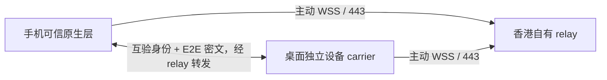

# 官方 API 与香港 relay 离线方案

用户已确认使用既有阿里云香港服务器作为 relay 的设计方向，尚未批准连接、部署、端口、证书、密钥或持久配对。本批没有访问该服务器或账户，没有真实用户密钥/凭据/Session IO，没有启用或重启已安装 DSH，也没有模型、上传、监听、模拟器或真机运行。所有密钥材料均来自源码内明确标记的固定公开测试 scalar，不能用于真实部署。

## 官方依据与实际编译

已安装 DevEco `26.0.0.851`、SDK `26.0.0.105`/API26、Hvigor `6.26.8` 被复用，未安装新工具。核对了本地 `@ohos.security.huks.d.ts`、`@ohos.security.cryptoFramework.d.ts` 与 Kit 声明；消费文档页只能取得动态空页，未登录或读取账号状态。官方公开参考是 [OpenHarmony HUKS API](https://raw.githubusercontent.com/openharmony/docs/master/en/application-dev/reference/apis-universal-keystore-kit/js-apis-huks.md)、[CryptoFramework API](https://raw.githubusercontent.com/openharmony/docs/master/en/application-dev/reference/apis-crypto-architecture-kit/js-apis-cryptoFramework.md)，桌面算法实现依据 [Node crypto](https://nodejs.org/api/crypto.html)。OpenHarmony master 参考不代替具体 HarmonyOS 手机能力验证。

HUKS 提供 key item 的生成、存在查询、公钥导出、签名 session、abort/finish 与删除；没有私钥导出接口进入本适配器。CE 是首次解锁后可访问，ECE 是设备解锁时可访问，ECE 仍需处理锁屏与 session 关闭。未声明硬件/TEE/SE 或生物认证已经验证，也没有选择需额外 SE 权限的配置。CryptoFramework 提供 ECC256/ECDH、SHA256、二进制 HKDF key、GCM AAD 与 16 字节 tag；本地声明明确规定 GCM tag 在加密输出末尾，解密须分离该 tag。HKDF 输入保留原始二进制，不经过字符串编码。

三个实际 `.ets` adapter 是 [NativeDeviceKeys](../harmony/entry/src/main/ets/native/NativeDeviceKeys.ets)、[NativeCryptoPrimitives](../harmony/entry/src/main/ets/native/NativeCryptoPrimitives.ets)、[NativeTransientAgreement](../harmony/entry/src/main/ets/native/NativeTransientAgreement.ets)。在独立 `local.dsh.mobile.cryptocheck`、无权限、无签名、无 daemon 的 project 完成真实 ArkTS 编译，应用未运行。编译器保留“并非所有设备支持相关 system capability”的警告和旧 HTTP adapter 的 INTERNET 警告；没有为消除警告申请权限，也不能据编译推断手机 API、硬件或后台能力。默认 host sandbox 的 SDK junction/realpath EPERM 只对原编译命令作窄 host 重试。

HUKS 返回值保持 `publicNativeBytes/signNativeBytes`，未猜测为 SPKI DER 或 P1363/DER 签名。真实 HUKS 字节编码、曲线名称、锁屏行为和跨端验签仍未观察；其格式转换是明确阻塞。SDK 替身使用 DER fixture，不能替代该证据。实际 create/delete 的失败报告 unverified/unknown outcome，不自动重试、覆盖现存 alias 或清理其他 key。

## 一套共享协议与离线证据

[共享异步状态机](../src/e2e-channel.ts)只有注入的 primitives 和 codec，没有 Node、网络、密钥生成或 persistence 依赖。[Node backend](../integration/p256-channel.ts)使用内建 crypto，[enrollment verifier](../integration/p256-enrollment.ts)验证真实库 ECDSA 签名并只在内存保存公钥 pin。原生 adapter 只实现底层操作，未复制握手/计数/撤销协议；同一 browser bundle 在 ETS SDK 替身和 Node backend 之间往返成功。实际原生 primitive 到可信 runtime 的注册和 HUKS wire formatting 尚未接入，不能直接启用。

首次 enrollment challenge 限时、限量、一次使用，签名绑定 desktop/profile/device、公钥 fingerprint、nonce 和期限。它证明持有候选公钥，不等于授权；仍须 phase34 的明确桌面确认、Session/operation/期限选择，真实界面还须让用户比对双方指纹。进程恢复没有自动恢复 grant，密钥存在也不产生执行权限。

两端每次连接必须使用新的 transient ECDH key 和 CSPRNG nonce。先交换仅含 role、临时公钥与 nonce 的 hello，使用固定顺序的 transcript 加上临时 room 派生 binding。HKDF-SHA256 为两个方向分离 AES256-GCM key 与 nonce prefix；加密 finished proof 验证事先确认的身份 pin，不接受 frame 自带公钥变成信任。只有双方 finished 后才返回 host-only transport object，再由 phase34 的 key/epoch/expiry/scope proof 创建独立 Peer。visible binding id 不能代替这个对象，也不称作 TLS exporter。

消息使用同一 shared counter state，header 的 protocol/binding/role/sequence/kind 全部作 AAD。tag、role、room/transcript、顺序、重放、长度和预算错误均拒绝；无明文 fallback。异步原语完成后再次检查关闭状态，晚到结果不能恢复连接；关闭清理已拥有的派生 buffer。不能保证 garbage-collected key object 的物理内存擦除。固定 invocation 上限是 `2^32-1`，部署预算显式配置且不得超过它。

12 个 crypto/owner 用例验证了真实库算法、rich HTML/Unicode 密文往返、错误 pin、跨 room、tamper、方向、重放/顺序、并发 counter、close race 和 phase34 撤销；7 个 SDK 替身用例验证原生 gate、alias 保留、unknown outcome、签名 abort、HKDF/GCM API 参数和跨 backend 共享状态。替身不算 native execution，未重跑全仓。证据分别为 [crypto](../evidence/phase35-vitest.json)、[scope](../evidence/phase35-crypto-scope.json)、[substitute](../evidence/phase35-native-substitute.tap) 与 [browser bundle](../evidence/phase35-browser-bundle.json)。自定义 framing/握手仍须独立安全审查，算法通过不等于生产安全认证。

## 香港 relay 的可见数据与职责

relay 只做 bounded room forwarding，不是 DSH 执行宿主。专用最小 `dsh` relay profile 只装 webServer 和 relay 插件，不加载 agent、Session、模型、credentials、operator Connection、`/api`、`$events` 或 shell bridge；不能启动 package bin 或另造 Node argv launcher。手机/桌面均主动连出，电脑不开放 inbound/LAN 端口。候选外部入口是 HTTPS/WSS 443 下独立路径，具体域名/现有服务状态尚未知；本机 proxy/upstream listener、系统服务、目录和限制需先只读核实并列出准确变更，不能覆盖现存应用。

外层 TLS 验证 relay 域名和证书，保护公网链路；其终止点在 relay，不能代替端到端身份验证和内容加密。relay 可见源/目标 IP、连接时刻/持续时间、方向、frame 大小与数量、临时 room/role、公开 ephemeral hello 和每连接 binding/counter，也可能看到短期 room join 授权。room/token 必须短期、限量、与 DSH grant 分离，绝不派生自稳定 device/Session id；未创建真实 token。正常帧的 device/desktop/profile/Session、长期身份 fingerprint、授权 scope、task、rich HTML、草稿、签名 proof 和消息正文都位于 E2E 密文内。relay 仍能相关联流量、丢弃/重排/延迟/限速或拒绝服务；可用性、流量分析、日志与云提供商可见性不能靠 E2E 隐藏。应用日志不记录 payload、key、token 或解密正文，metadata 保留规则应明确限量限时。

撤销由桌面授权 owner 控制，先拒绝新请求和现有 lease，再清理 connection/follow/mount；relay token 撤销只是停止转发，不能代替设备 grant 撤销。断线重连重新握手、使用新 key/counter并查询原 journal；已接受桌面工作继续执行，不能因 socket 断线自动重执行。到期 watchdog、后台/锁屏清理、public-pin 轮换和 relay join/reconnect transport 都尚未接入真实 lifecycle。

## 集中实施清单与最少待决策

服务器位置已选定。仅剩实际部署所需的 relay 域名/既有入口信息，以及手机 API/连接/签名方式确认；不要求先选择真实历史会话。首轮建议新增独立合成 Session，明确短期只读 `session.sync/task.receipt`，模型/上传/真实任务为零，审批回复持续拒绝。提交/取消/rich 写操作和长期自动授权后续分别确认。

集中批准前应补齐：只读服务器 public 环境/443/service/path inventory 的连接目标与方式；实际 Node/DSH runtime 兼容性；准确 relay/profile artifact hash、安装目录、TLS 来源、upstream/listener 和文件 diff；依赖/安全审查；HUKS 格式与实际 API 的设备证据；手机 signer/key-owner registration、enrollment UI 指纹检查、expiry watchdog、WSS/relay broker 实现；具体 synthetic Session id/工作目录/operations/TTL 与撤销、去重验收。现在只有离线源码/HAP compile artifact，尚没有可部署 relay 或新桌面插件包。

随后可集中批准的实际步骤是：指定服务器只读确认并复核准确配置；在确认后的独立最小 profile 安装核验产物并保持禁用；仅按已列 diff 配置明确 relay HTTPS/path/service及限量日志；在明确手机测试应用/签名权限下验证 native 字节互操作；另行确认真实设备/桌面 signer 初始化与短期 synthetic scope 配对及启用。任何新增公网/LAN/防火墙、DNS/TLS private key/证书、ssh credentials、root service、费用、后台权限或持久访问都须在批准内容中明确，不能从“香港服务器可以”推导。不可把真实密钥、签名/配对或宿主重启混入只读检查；现有定制 DSH、其他服务、真实会话和历史证据保持完整，回退仅停止/移除新 profile/route/dependency，grant/key 删除另行确认。
