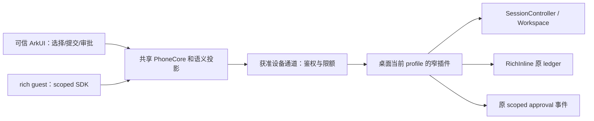

> 本文是生成副本，仓库相对引用保留为源码位置，不代表安装文件。

# 从隔离回放接入用户桌面

本参考给出下一阶段路线。选择桌面当前 profile 内的可选窄插件，复用既有服务和 Gateway，不新增一个 SDK runtime 代替用户桌面。以下结论来自只读源码与已封存的合成实验；安装实例的 release、已启用插件和运行端点尚未核实。本阶段不启动桌面、读取真实会话/凭据、安装、签名或开放网络。

## 现有可复用部分

| 已有接口 | 可复用内容 | 接入差距 |
| --- | --- | --- |
| SessionController（源码引用：../../../packages/api/session-controller/src/index.ts） | list/create/prompt/cancel/page/follow/projections/control；真实 agent 和 Session 归属 | 实验直接调用隔离 Context；生产要选择正确桌面 profile/Workspace/Session，不能另启 runtime 写同一会话 |
| RestrictedDesktopAdapter（源码引用：../src/desktop-adapter.ts） | 窄 operation 映射、scope、mount、原 requestId/actionId、admission journal | environment 只允许 synthetic-only；MockDeviceRegistry 不是鉴权。需独立的已验证生产工厂，不能删除守卫或伪装 environment |
| MobileBff（源码引用：../integration/mobile-bff.ts） / Gateway（源码引用：../../../packages/api/gateway/src/types.ts） | 已有 harmonyMobile request/follow，固定 namespace/method，生成 codec、取消与 stream framing | 原 HTTP/NDJSON loopback 外载体用于测试；产品应复用 plugin 及 Gateway 能力，不允许手机选择任意 RPC namespace |
| Workspace/读绑定（源码引用：../integration/read-services.ts） | 已有 Workspace、Session list/page、经过会话证明的附件读取 | 合成 allowlist 要换为 host 绑定的用户/设备授权；先做有界目录，不把路径或账户信息给 guest |
| RichInline（源码引用：../../../packages/experimental/rich-inline/src/host/index.ts） | 原 ledger、CAS、mount/snapshot/saveDraft/invoke/status/dispose、历史与 fork 规则 | 要先发现该插件及同版投影/codec；不能复制 ledger 或把 Electron bridge 搬到 ArkWeb |
| Remote events（源码引用：../../../packages/api/remotes/src/remote-events.ts） | approval/request、user-questions/request 既有 scoped waterfall；Gateway 保留 pending eventId 和 generation | 当前审批端口只返回 []；需保持原 Agent、eventId、取消寿命与一次结果，不能由 rich guest 自动 next 或回答 |
| Plugin Manager（源码引用：../../../packages/boot/plugin-manager/src/types.ts） | 当前 profile 安装/启用、受控 reload、restart-required、回退 | 用户安装的 packaged runtime 版本及兼容状态未知；只能在批准后经官方管理通道激活 |

SessionFollowRequest 目前接受 address/window 和 assistantStream，不接受手机的 afterSeq。手机 relayCursor 与 Session seq 是两种序列；继续使用已有 snapshot/live baseline 和移动 journal 恢复，不把字段直接当作官方 resume 参数。SDK stdio 的 方法表（源码引用：../../../packages/sdk/protocol/src/types.ts）只有 initialize、prompt、wait、cwd、shutdown，客户端会 spawn 新 runtime（源码引用：../../../packages/sdk/client/src/client.ts）；没有 attach 现有桌面、cancel、rich 或审批回应，因此不是本产品的桌面接入入口。

## 最小实现顺序

先做 capability 与版本解析：只读公开包 metadata，声明所需 service/Remote codec/rich projection 版本，不兼容时停用对应能力并给出明确原因。插件在当前桌面 Context 内消费生产服务端口，继续使用现有 admission/lease 逻辑；只替换绑定工厂和载体，不改 agent loop，不把 fixture profile 或 replay guard 混入产品激活。

再完成无联网、无凭据的生产 binding 测试和目录/会话状态 UI。运行所有操作之前由 host 从已鉴权通道注入 device/desktop/grant/session/operation 范围；command 中的自报身份不构成权限。继续采用显式 resolve(request) 得到完整 spec，取消订阅不取消已接纳桌面任务，连接中断先查旧 receipt，不生成新 intent 重派发。

随后做审批适配：从已有 scoped 事件获得 pending 请求，生成原生可读 DTO，明确取消、过期、重复或竞争回应行为。真正决定只能由可信 ArkUI 发起并返回原 waterfall；没有受理权时调用 next() 委托已有桌面回答者。授权、账户 secret prompt 和任意 host RPC 都不进入 rich guest。先保持手机审批展示只读，回应能力通过单独设计与测试后才激活。

Remote events 的现有 allowlist 还包含 credentials、账户、插件管理等通知，Gateway 不负责业务字段裁剪；不把整个 operator $events 通道转发给手机。窄插件只投影获准的会话 activity/approval 生命周期，保留原 pending 事件的结果归属和取消寿命。

最后才选择真实设备通道。当前 Connection.admit（源码引用：../../../packages/client/connection/src/rpc-host.ts） 在 Host/Origin 与 cookie 检查后授予完整 operator Peer。它不是每设备 grant，不能把桌面 operator cookie、launch URL 或任意 /api 访问权复制到手机。优先让窄插件使用现有 Gateway/服务并在获准的设备通道上只发送授权消息；共享监听器或认证扩展若确有必要，只做经审查的局部贡献。WAN 载体可替换，部署留到明确批准之后，不在此阶段建 relay、隧道或服务端。

## 可自主继续的模块

| 模块 | 可执行范围 | 完成条件 |
| --- | --- | --- |
| capability/version resolver | 纯 TS、公开 metadata fixture、生成导出比对 | 缺失/版本错配 fail loud；不读取用户配置 |
| production binding factory | 注入假 typed service ports；保留 synthetic guard；package/profile 方案 | 已有方法映射和作用域测试通过；未注册 listener、未装插件 |
| 原生目录/会话/状态 UI | 合成有界目录、错误/readonly/迁移提示、locale-owned copy | ArkTS 源码与可离线编译；运行资格单列 |
| approval projection 与生命周期 | 合成 Agent/eventId、撤回/过期/竞争回应 | 原生决定接口不可被 guest 调用；默认展示只读 |
| 设备授权/撤销/接纳 spec | 没有真实密钥的验证端口与持久化失败 fixture | 不自写 crypto、不生成长期凭据；claim 先写、unknown 不重派发 |
| 载体接口 | 现有 Remote framing/ByteNetworkPhone 的 mock adapter | 不再复制 reducer/guest SDK；configured-https 不被虚假启用 |

## 需要明确批准的步骤

1. **桌面安装/激活**：先提供精确 package/bundle、版本与 hash、当前桌面公开 runtime 兼容报告、要改的 profile rows、reload 或 restart-required 结果及回退。安装/启用与可能的受控重启需对应批准；绝不替换 Electron 已安装资源或静默重启。
2. **选定真实数据/操作范围**：明确允许的 Workspace、Session 和目录，以及是否仅只读。读取真实会话、附件或发起实际任务必须获得这个范围的批准；模型路线及费用确认也不能由 replay 资格代替。
3. **持久设备访问和配对**：明确设备、可执行操作、会话范围、期限、撤销办法和存储在既有 credentials/storage owner 的记录。创建密钥/长期凭据、实际配对及持久 grant 激活需批准；默认未配对且无访问权。
4. **手机签名/安装/权限**：先确认真实 OS/API 与工具版本，再说明官方签名方式、账户/证书操作、包与权限列表及卸载。签名账户、真机安装、设备权限逐项授权；不安装未知来源软件，不上架、不付费。
5. **真实网络**：给出具体 LAN/public bind、端口、TLS/证书、服务器/隧道/VPN、数据可见性、保留策略及成本。监听、防火墙、远程隧道、证书和 relay 部署需对应批准，不能把现有 loopback/HDC 许可扩大为 WAN。

这些步骤是待执行计划，没有运行安装命令或实际桌面 RPC。下一次接入应先在官方 profile 的独立合成演练中核对生成 codec 与服务组合，再经批准把同一绑定装入用户当前桌面。安装实例的兼容结果以公开 metadata 和后续实际演练为准，不从主仓 alpha.2 或 dirty 源码推断。
